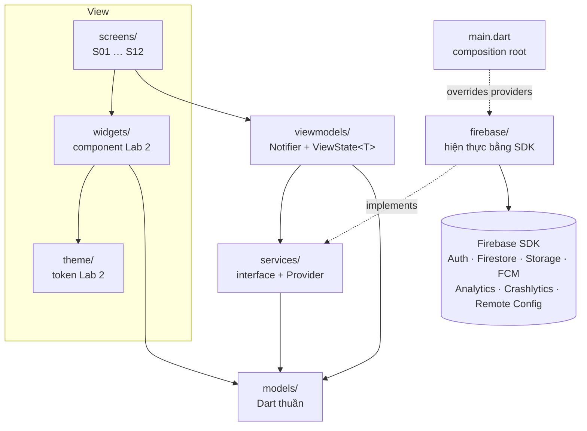
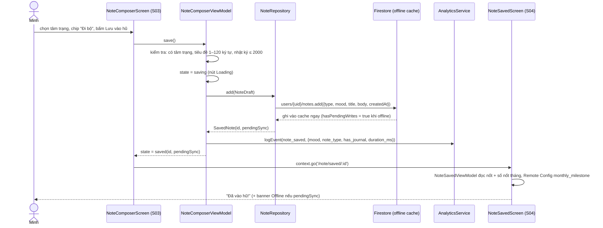

# Kiến trúc app Nốt (Lab 3)

Đầu ra của Stage 2 (Architect). Tài liệu này mô tả app mobile; kiến trúc cả hệ thống cho Final Assignment (web admin, `packages/core/`, AI) ở [`system-architecture.md`](system-architecture.md). Ánh xạ thiết kế Lab 2 sang code ở [`design-traceability.md`](design-traceability.md).

## 1. Nguyên tắc

- **MVVM + Riverpod 3.** View (`screens/`, `widgets/`) → ViewModel (`viewmodels/`) → Service (`services/`) ← hiện thực Firebase (`firebase/`). Phụ thuộc chỉ đi xuống; một lớp không bao giờ import lớp phía trên.
- **Widget không gọi SDK.** Không widget nào dùng `FirebaseAuth.instance`, `FirebaseFirestore.instance`, `FirebaseAnalytics.instance`, `http`… Mọi lời gọi ra ngoài đi qua một interface trong `services/`.
- **Logic nghiệp vụ nằm ngoài `build()`.** Lọc, đếm, gom nhóm theo ngày, kiểm tra dữ liệu nằm ở ViewModel hoặc service. `build()` chỉ đọc state và vẽ.
- **Mỗi màn tải dữ liệu có state tường minh** `ViewState<T>` (sealed: `Loading`, `Empty`, `Failure`, `Data`), do ViewModel sở hữu.
- **Service được inject.** Mỗi interface có một `Provider` khai báo trong `services/`. Hiện thực Firebase được gắn vào ở `main.dart` (composition root) bằng `ProviderScope(overrides: …)`. Test gắn bản fake theo cùng cách.
- **Không có trạng thái toàn cục thay đổi được.** Không `setState` cho state dùng chung, không singleton đọc từ widget.
- **Design system nằm một chỗ** (`lib/theme/`). Widget đọc màu, chữ, khoảng cách từ theme; mã màu, cỡ chữ hay padding viết cứng trong màn hình là lỗi.

## 2. Cấu trúc thư mục

Đi theo cấu trúc gợi ý của đề (mục 5), thêm `router/` cho go_router.

```text
lib/
├── main.dart          Composition root: khởi tạo Firebase, gắn hiện thực service vào ProviderScope, runApp
├── app.dart           MaterialApp.router: theme, locale vi, router
├── router/            Đường dẫn, GoRouter (redirect theo trạng thái đăng nhập), shell 4 tab
├── theme/             Token Lab 2: ColorScheme, TextTheme, AppColors, AppSpace, AppRadius, AppElevation, AppSize
├── models/            Dữ liệu thuần Dart, không phụ thuộc Flutter/Firebase: Note, Mood, NoteType, Challenge…
├── services/          Interface (abstract) + Provider của từng service; ViewModel chỉ biết tới lớp này
├── firebase/          Hiện thực service bằng Firebase SDK (Auth, Firestore, Storage, FCM, Analytics, Crashlytics, Remote Config)
├── viewmodels/        Notifier của Riverpod, mỗi màn một ViewModel; ViewState<T> dùng chung
├── screens/           Một thư mục mỗi màn S01–S12; chỉ dựng UI từ state của ViewModel
├── widgets/           Component Lab 2 dùng lại (nút, ô nhập, tờ nốt, thanh tab, dialog, trạng thái…)
└── utils/             Hàm thuần dùng chung: định dạng ngày tiếng Việt, kiểm tra dữ liệu nhập

assets/mascot/         SVG Tụi Nốt (8 trạng thái), chép từ repo Lab 2
test/                  Test theo cùng cây thư mục; test/support/ chứa fake service và helper
e2e_test/              (Stage 6) bộ test ARTEMIS bằng pytest
firebase/              Rules, index, Remote Config defaults, test rules trên Emulator
```

Quy tắc import giữa các thư mục (được kiểm tra khi review code):

| Thư mục | Được import | Không được import |
|---|---|---|
| `models/` | `dart:*` | mọi thư mục khác, Flutter, Firebase |
| `services/` | `models/` | `firebase/`, `viewmodels/`, `screens/`, `widgets/` |
| `firebase/` | `services/`, `models/`, Firebase SDK | `viewmodels/`, `screens/`, `widgets/` |
| `viewmodels/` | `services/`, `models/`, `utils/` | `firebase/`, `screens/`, `widgets/`, Firebase SDK |
| `widgets/` | `theme/`, `models/`, `utils/` | `services/`, `firebase/`, `viewmodels/` |
| `screens/` | `viewmodels/`, `widgets/`, `theme/`, `models/`, `router/` | `services/`, `firebase/`, Firebase SDK |
| `main.dart` | tất cả (chỉ để lắp ráp) | — |

## 3. Sơ đồ lớp



`firebase/` trỏ lên `services/` vì nó *hiện thực* interface ở đó, không phải gọi ngược lên. ViewModel không biết Firebase tồn tại, nên test ViewModel chỉ cần một fake service.

## 4. Luồng dữ liệu: F1 Ghi nốt buổi tối

Từ lúc chạm "Lưu vào hũ" ở `S03c` tới khi thấy `S04`. Đây cũng là đoạn đo tiêu chí thành công "dưới 30 giây".



Khi Firestore trả lỗi quyền (`permission-denied`) hoặc lỗi khác, `NoteRepository` ném `AppException`; ViewModel chuyển state về `editing` với thông báo lỗi, ghi lỗi non-fatal qua `CrashReporter`, và giữ nguyên nháp.

## 5. ViewModel và service

| ViewModel | Màn | State | Service dùng |
|---|---|---|---|
| `AuthViewModel` | S01, redirect của router | `AuthState` (signedOut, signingIn, signedIn, failure) | `AuthService`, `UserRepository`, `AnalyticsService`, `CrashReporter`, `MessagingService` |
| `TodayViewModel` | S02 | `ViewState<TodaySummary>` | `NoteRepository`, `DraftStore`, `Clock` |
| `NoteComposerViewModel` | S03 | `NoteComposerState` (bước, tâm trạng, tiêu đề, nhật ký, saving, lỗi) | `NoteRepository`, `DraftStore`, `RemoteConfigService`, `AnalyticsService`, `CrashReporter`, `Clock` |
| `NoteSavedViewModel` | S04 | `ViewState<SavedNoteSummary>` | `NoteRepository`, `RemoteConfigService` |
| `JarViewModel` | S05 | `ViewState<List<Note>>` + phân trang + hoàn tác xoá | `NoteRepository`, `AnalyticsService` |
| `NoteDetailViewModel` | S06 | `ViewState<Note>` + chế độ sửa | `NoteRepository`, `AnalyticsService` |
| `ChallengesViewModel` | S07 | `ViewState<ChallengeDeck>` | `ChallengeRepository`, `AnalyticsService` |
| `ChallengeDetailViewModel` | S08 | `ViewState<Challenge>` + kết quả | `ChallengeRepository`, `NoteRepository`, `AnalyticsService` |
| `SelfControlViewModel` | S09 | `ViewState<SelfControlSummary>` + khoá | `NoteRepository`, `HabitRepository`, `LocalAuthService`, `SettingsRepository` |
| `BreathingViewModel` | S10 | `BreathingState` (nhịp, thời gian còn lại, xong) | `NoteRepository` (khi ghi vào hũ), `Clock` |
| `JourneyViewModel` | S11a/b/c | `ViewState<JourneyData>` theo tab con | `NoteRepository`, `ChallengeRepository`, `JourneyStats` (hàm thuần) |
| `WeeklyReportViewModel` | S11b Thẻ tuần | `ReportState` (idle, building, uploading(progress), done(url), failure) | `ReportService`, `StorageService`, `AnalyticsService`, `CrashReporter` |
| `SettingsViewModel` | S12 | `ViewState<UserSettings>` | `SettingsRepository`, `MessagingService`, `AuthService`, `AnalyticsService` |
| `FirebaseDemoViewModel` | S12 khu demo | `FirebaseDemoState` (thông báo đã nhận, giá trị RC) | `NotificationInbox`, `RemoteConfigService`, `CrashReporter` |

| Service (interface) | Hiện thực | Việc làm |
|---|---|---|
| `AuthService` | `FirebaseAuthService` | Google Sign-In, email/mật khẩu, đăng xuất, luồng trạng thái đăng nhập |
| `UserRepository` | `FirestoreUserRepository` | `users/{uid}` (tạo lần đầu với `role = user`, cài đặt) |
| `NoteRepository` | `FirestoreNoteRepository` | CRUD `users/{uid}/notes`, đếm theo tháng/loại, truy vấn theo khoảng ngày |
| `ChallengeRepository` | `FirestoreChallengeRepository` | Đọc `challenges`, tiến độ `users/{uid}/challengeProgress` |
| `HabitRepository`, `SettingsRepository` | Firestore | Thói quen muốn bớt, giờ nhắc, Giờ tỉnh, công tắc riêng tư |
| `DraftStore` | `SharedPrefsDraftStore` | Nháp S03 trên máy |
| `StorageService` | `FirebaseStorageService` | Tải PDF lên `reports/{uid}/…`, phát tiến độ, trả URL |
| `ReportService` | `PdfReportService` | Dựng PDF Thẻ tuần từ dữ liệu đang xem |
| `AnalyticsService` | `FirebaseAnalyticsService` | Sự kiện theo `analytics-plan.md`, `setUserId` sau đăng nhập |
| `CrashReporter` | `FirebaseCrashReporter` | Lỗi non-fatal, crash thử, user ID, custom key |
| `RemoteConfigService` | `FirebaseRemoteConfigService` | Giá trị mặc định trong app, fetch + activate, lắng nghe cập nhật realtime |
| `MessagingService`, `NotificationInbox` | FCM + `flutter_local_notifications` | Xin quyền, nhận ở 3 trạng thái app, lưu danh sách, điều hướng khi chạm |
| `LocalAuthService` | `local_auth` | Mở khoá phần Tự chủ |
| `Clock` | `SystemClock` | Giờ hiện tại (test dùng giờ cố định) |

Cột "Hiện thực" được dựng ở Stage 3–5; Stage 2 chỉ dựng lớp View, theme và model.

## 6. Design system trong code

| Lab 2 | Code |
|---|---|
| Color variables | `theme/app_colors.dart`: `ColorScheme` (vai trò M3) + `AppColors` (`ThemeExtension`) cho màu riêng (tâm trạng, loại nốt, biểu đồ, `success`, `warning`…) |
| Text Styles | `theme/app_typography.dart`: `TextTheme` theo bảng handout 1.2 + `AppTextStyles` (`ThemeExtension`) cho 4 kiểu không có trong M3 |
| Size, radius, elevation | `theme/app_tokens.dart`: `AppSpace`, `AppRadius`, `AppElevation`, `AppSize` |
| Component theme | `theme/app_theme.dart`: nút cao 48 / rộng ≥ 64, `AppBar` 48, `NavigationBar` 64, `Switch` tắt màu `switch-off`, `SegmentedButton` 48, `materialTapTargetSize.padded` |
| Component | `widgets/`, bảng đầy đủ ở `design-traceability.md` mục 3 |

Cách đọc token trong widget: `Theme.of(context).colorScheme`, `Theme.of(context).textTheme`, `AppColors.of(context)`, `AppTextStyles.of(context)`, hằng `AppSpace.*` / `AppRadius.*`.

Font Be Vietnam Pro được gắn qua tham số `fontBuilder` của `AppTheme.light()`: app thật truyền `GoogleFonts.beVietnamPro`, test dùng font mặc định để không gọi mạng.

Accessibility (checklist Lab 2): vùng chạm ≥ 48 dp do theme và kích thước component đảm bảo; chữ nội dung ≥ 14 sp (`bodySmall` trở lên); tâm trạng luôn có màu + mặt mascot + chữ; widget chính có `Semantics` label (ARTEMIS đọc cây accessibility trước). Kiểm tra bố cục ở 360 dp và 412 dp bằng widget test.

## 7. Điều hướng

`router/app_router.dart` dựng `GoRouter` trong một Provider. Bốn tab nằm trong `StatefulShellRoute.indexedStack`; màn lồng là route cấp cao để che thanh tab. Bảng route ở `design-traceability.md` mục 1.

- **Redirect theo đăng nhập (Stage 3):** chưa đăng nhập → `/welcome?next=<đích>`; đã đăng nhập mà ở `/welcome` → `next` hoặc `/today`. Router lắng nghe `AuthService.authStateChanges()` qua `refreshListenable`.
- **Back:** tab khác Hôm nay → về Hôm nay; ở Hôm nay → thoát app (theo handout mục 3).
- **Thông báo:** dữ liệu `route` trong payload FCM được map sang đường dẫn (S03, S02, S08) rồi `go()`.

## 8. Xử lý lỗi

- Service đổi lỗi SDK sang `AppException` (`network`, `permissionDenied`, `cancelled`, `notFound`, `unknown`) để ViewModel không phụ thuộc kiểu lỗi Firebase.
- ViewModel đổi `AppException` thành state có thông báo tiếng Việt theo tone Lab 2 ("Chưa tải được hũ. Kiểm tra Wi-Fi rồi thử lại.").
- Lỗi trên đường xử lý thật (lưu nốt, tải PDF) được ghi non-fatal qua `CrashReporter`.
- Tải dữ liệu quá 10 giây → `Failure` (flow T3 → T2).
