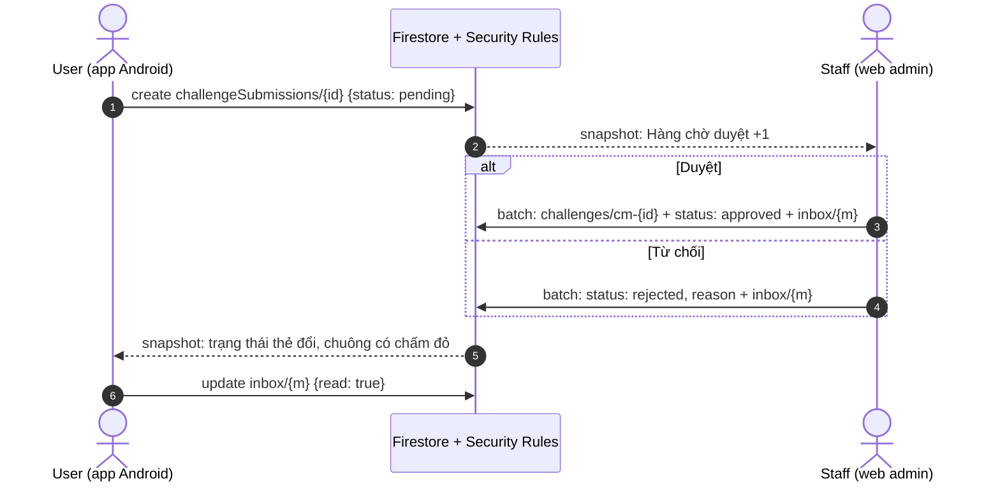

# Luồng liên vai trò: người dùng gửi thẻ, staff duyệt

Final Assignment, Stage 5. Luồng đi qua hai vai trò (`user`, `staff`) và hai
client (app Android, web admin), nối nhau chỉ qua Firestore: không client nào
gọi client kia, mỗi bên ghi rồi bên kia nhận qua snapshot listener.

## Các bước

| # | Ai, ở đâu | Màn | Ghi Firestore | Rule cho phép | Bên kia thấy gì |
|---|---|---|---|---|---|
| 1 | User, app | Thử thách → thẻ tự thêm → "Gửi cho mọi người" | Tạo `challengeSubmissions/{id}`: `uid` = mình, `topic`, `title`, `minutes`, `tip`, `customId`, `status = pending`, `createdAt` = giờ server | `challengeSubmissions` `create`: đã đăng nhập, `uid` = mình, `status == 'pending'`, hình dạng hợp lệ | Web: thẻ hiện ngay ở Hàng chờ duyệt, số trên icon tăng |
| 2a | Staff, web | Hàng chờ duyệt → Duyệt (chọn cấp) | Một batch: tạo `challenges/cm-{id}` (`source = community`, `status = active`), sửa submission `status = approved`, `reviewedBy`, `reviewedAt`, `challengeId`, tạo `users/{uid}/inbox/{auto}` `kind = submission_approved` | `challenges` `create` (staff, `validChallenge`); submission `update` (`pending → approved`, chỉ trường duyệt); `inbox` `create` (staff) | App: thẻ đổi thành "Đã vào kho chung ✓", chuông có chấm đỏ, hộp thư có "Thẻ của bạn đã vào kho chung" |
| 2b | Staff, web | Hàng chờ duyệt → Từ chối (lý do) | Một batch: submission `status = rejected`, `reason`, `reviewedBy`, `reviewedAt`; tạo tin `submission_rejected` | submission `update` (`pending → rejected`, `reason` không rỗng); `inbox` `create` | App: thẻ đổi thành "Chưa được duyệt: {lý do}" kèm "Gửi lại"; hộp thư có tin |
| 3 | User, app | Hộp thư (chuông) | `users/{uid}/inbox/{id}.read = true` | `inbox` `update`: chủ, chỉ `read` | — |
| 4 | Mọi user, app | Thử thách | — (đọc) | `challenges` `read`: đã đăng nhập | Thẻ mới nằm trong chồng thẻ của chủ đề / cấp staff chọn |

Remote Config `challenge_submissions_enabled = false` ẩn nút gửi trên app
(thẻ đã gửi vẫn hiện trạng thái); web admin hiện cảnh báo nhưng vẫn duyệt được
thẻ đã gửi.

## Sơ đồ

## Đo thời gian

Thời gian từ lúc staff bấm **Duyệt** trên web admin tới lúc app trên điện
thoại đổi trạng thái thẻ (snapshot Firestore tới máy).

Cách đo trên hệ thống đã deploy (10/11/2026): web admin bản thật
`https://prm393-not-lab3.web.app/admin/` (đăng nhập admin), app bản debug từ
`main` (`1aec01a`) trên **Galaxy A70, Android 11**, cả hai nối project thật.
Mốc bấm lấy từ `performance.now()` của trang ngay trước khi bấm Duyệt trong hộp
thoại; `reviewedAt` là giờ máy chủ Firestore đọc lại sau khi duyệt; mốc trên
điện thoại là lần đọc UI (`uiautomator dump`, mỗi lần khoảng 2 giây) đầu tiên
thấy "Đã vào kho chung ✓". Đồng hồ máy tính và máy chủ lệch không đáng kể
(bấm → `reviewedAt` đều khoảng 1,4 s ở cả ba lần).

| Lần | Môi trường | Thẻ | Bấm Duyệt → máy chủ ghi (`reviewedAt`) | Bấm Duyệt → app cập nhật | Kết quả trên app |
|---|---|---|---|---|---|
| E-1 | Emulator (máy dev, Android emulator) | thẻ seed | — | ≤ 3,3 s | Thẻ đổi "Đã vào kho chung ✓", chuông 1 tin |
| D-1 | Hệ thống đã deploy | "Dọn một góc nhỏ" | 1,4 s | 21–23 s (xem ghi chú) | "Đã vào kho chung ✓ Ai cũng nhận được…", chuông có tin |
| D-2 | Hệ thống đã deploy | "Giãn cơ 5 phút" | 1,4 s | ≤ 3,4 s | Như trên |
| D-3 | Hệ thống đã deploy | "Đi bộ 10 phút" | 1,5 s | ≤ 2,3 s | Như trên; hộp thư có đủ 3 tin "Thẻ của bạn đã vào kho chung" |

Ghi chú:

- **Lỗi tìm ra khi chạy D-1.** Hai lần bấm Duyệt đầu tiên báo "Có lỗi xảy ra.
  Thử lại sau ít phút." và thẻ vẫn chờ duyệt. Nguyên nhân: bước duyệt đợi
  `catalogProvider.future` để xếp thẻ mới cuối cấp; khi staff chưa mở màn Kho
  thẻ, provider không có ai lắng nghe nên Riverpod tạm dừng nó, future không
  xong và hết giờ sau 10 giây. D-1 chạy được sau khi mở màn Kho thẻ trước. Đã
  sửa (đọc kho thẻ thẳng từ repository) kèm test hồi quy, nhánh
  `fix/admin-approve-catalog`.
- D-1 chậm hơn hẳn hai lần sau dù máy chủ ghi sau 1,4 s: điện thoại vừa mở lại
  app và đứng yên ở màn Thử thách nhiều phút trong lúc tìm lỗi trên, kết nối
  lắng nghe của Firestore có thể đã ngủ. D-2 và D-3 chạy liền nhau cho số đo ổn
  định 2–4 s.
- Số đo trên điện thoại là cận trên: một lần đọc UI mất khoảng 2 giây, nên trễ
  thật nhỏ hơn hoặc bằng số ghi.

Ảnh: [`evidence/cross-role/`](../evidence/cross-role/): hộp thoại gửi thẻ, thẻ
"Đang chờ duyệt", thẻ "Đã vào kho chung" sau từng lần duyệt, hộp thư 3 tin.

## Kiểm thử

- Rules: R-20…R-24 trong `firebase/tests/firestore.rules.test.js`.
- Repository: `packages/core/test/firestore_repositories_test.dart` (gửi,
  duyệt tạo thẻ + tin, từ chối cần lý do).
- Web admin: `web_admin/test/session_test.dart` (từ chối tài khoản `user`).
