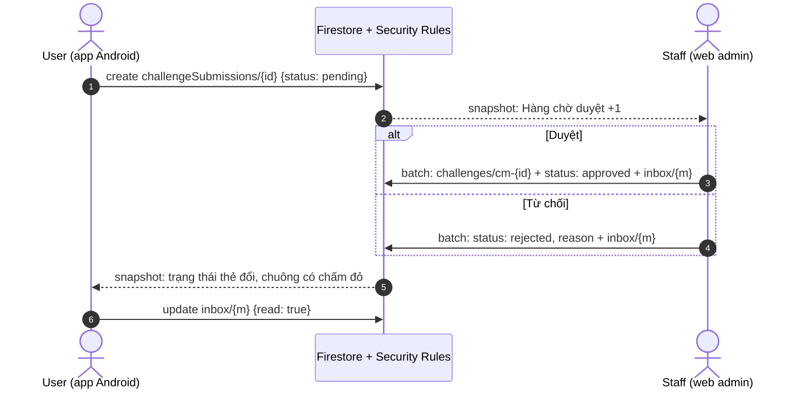

# Luồng liên vai trò: người dùng gửi thẻ, staff duyệt

Final Assignment, Stage 5. Luồng đi qua hai vai trò (`user`, `staff`) và hai
client (app Android, web admin), nối nhau chỉ qua Firestore: không client nào
gọi client kia, mỗi bên ghi rồi bên kia nhận qua snapshot listener.

## Các bước

| # | Ai, ở đâu | Màn | Ghi Firestore | Rule cho phép | Bên kia thấy gì |
|---|---|---|---|---|---|
| 1 | User, app | Thử thách → thẻ tự thêm → "Gửi cho mọi người" | Tạo `challengeSubmissions/{id}`: `uid` = mình, `topic`, `title`, `minutes`, `tip`, `customId`, `status = pending`, `createdAt` = giờ server | `challengeSubmissions` `create`: đã đăng nhập, `uid` = mình, `status == 'pending'`, hình dạng hợp lệ | Web: thẻ hiện ngay ở Hàng chờ duyệt, số trên icon tăng |
| 2a | Staff, web | Hàng chờ duyệt → Duyệt (chọn cấp) | Một batch: tạo `challenges/cm-{id}` (`source = community`, `status = active`), sửa submission `status = approved`, `reviewedBy`, `reviewedAt`, `challengeId`, tạo `users/{uid}/inbox/{auto}` `kind = submission_approved` | `challenges` `create` (staff, `validChallenge`); submission `update` (`pending → approved`, chỉ trường duyệt); `inbox` `create` (staff) | App: thẻ đổi thành "Đã vào kho chung ✓", chuông có chấm đỏ, hộp thư có "Thẻ của bạn đã vào kho chung" |
| 2b | Staff, web | Hàng chờ duyệt → Từ chối (lý do) | Một batch: submission `status = rejected`, `reason`, `reviewedBy`, `reviewedAt`; tạo tin `submission_rejected` | submission `update` (`pending → rejected`, `reason` không rỗng); `inbox` `create` | App: thẻ đổi thành "Chưa được duyệt: {lý do}" kèm "Gửi lại"; hộp thư có tin |
| 3 | User, app | Hộp thư (chuông) | `users/{uid}/inbox/{id}.read = true` | `inbox` `update`: chủ, chỉ `read` | — |
| 4 | Mọi user, app | Thử thách | — (đọc) | `challenges` `read`: đã đăng nhập | Thẻ mới nằm trong chồng thẻ của chủ đề / cấp staff chọn |

Remote Config `challenge_submissions_enabled = false` ẩn nút gửi trên app
(thẻ đã gửi vẫn hiện trạng thái); web admin hiện cảnh báo nhưng vẫn duyệt được
thẻ đã gửi.

## Sơ đồ

## Đo thời gian

Thời gian từ lúc staff bấm Duyệt / Từ chối (ghi trên web) tới lúc app đổi trạng
thái thẻ (snapshot tới máy). Đo bằng đồng hồ bấm giờ trên video, cả hai màn
cùng hiện.

| Lần | Môi trường | Thao tác | Ghi trên web | App cập nhật | Trễ |
|---|---|---|---|---|---|
| E-1 | Emulator (máy dev, Android emulator) | Duyệt | 9/11/2026 ~11:22 | Thẻ đổi "Đã vào kho chung ✓", chuông 1 tin | ≤ 3,3 s (gồm ~2 s mỗi lần đọc UI bằng `uiautomator`, nên trễ thật thấp hơn) |
| D-1 | Hệ thống đã deploy | | | | |
| D-2 | Hệ thống đã deploy | | | | |
| D-3 | Hệ thống đã deploy | | | | |

_Ba lần trên hệ thống đã deploy được chạy khi quay video demo; điền số đo vào
bảng này kèm ảnh chụp ở `evidence/`._

## Kiểm thử

- Rules: R-20…R-24 trong `firebase/tests/firestore.rules.test.js`.
- Repository: `packages/core/test/firestore_repositories_test.dart` (gửi,
  duyệt tạo thẻ + tin, từ chối cần lý do).
- Web admin: `web_admin/test/session_test.dart` (từ chối tài khoản `user`).
