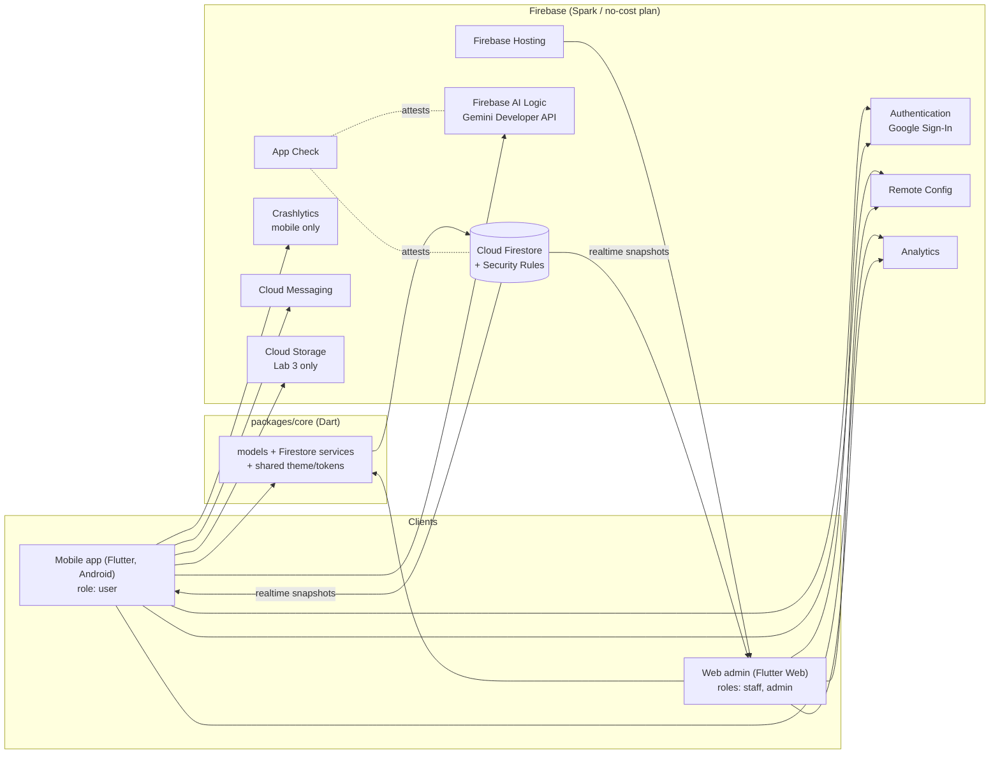
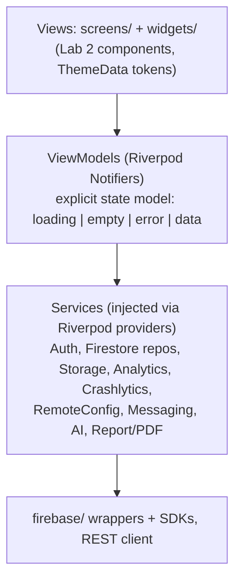
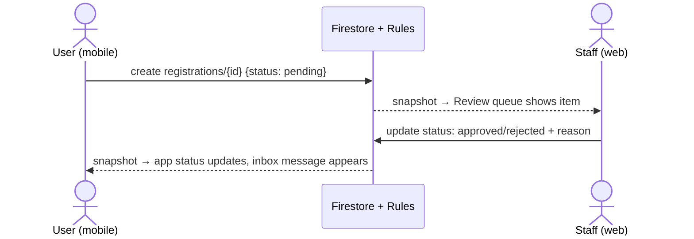

# Overall System Architecture

Derived from two handouts: **Lab 3 – Cloud-Enabled Mobile App** and **Final Assignment – One Complete System on Firebase**. Lab 3 delivers the mobile app; the Final Assignment extends the same repository into a multi-role system (mobile + web admin + shared Firebase backend + Gemini AI feature).

## 1. Scope at a glance

| | Lab 3 | Final Assignment |
|---|---|---|
| Clients | Flutter mobile (Android) | Flutter mobile + Flutter Web admin (Firebase Hosting) |
| Roles | One persona (Lab 2) | `user` (mobile), `staff`, `admin` (web) |
| Backend | Firebase: Auth, Cloud Storage, FCM, Analytics, Crashlytics, Remote Config | Shared Firestore + Auth, FCM, Analytics, Crashlytics (mobile), Remote Config, App Check, Firebase AI Logic. **No custom server.** |
| Data source | Public REST API *or* Firestore | All data on Firestore |
| Architecture | MVVM + Provider/Riverpod | MVVM in both clients, shared `packages/core/` |
| Testing | ARTEMIS E2E (≥10 cases, 3 runs each), AI code review (≥5 findings, ≥3 fixes) | + Security Rules tests (Emulator), web checklist, cross-role E2E ×3, ≥3 review findings |
| Grade | 10 pts (6 product, 4 process) | 10 pts (8 system, 2 slides/video), +0.5 bonus |

> **Resolved for the Final.** Lab 3 uploaded the weekly-card PDF to Cloud Storage. The Final Assignment puts Cloud Storage out of scope and asks for the PDF to be *saved and shared on the device, with its metadata in Firestore*. The app now builds the PDF with `pdf` (bundled Be Vietnam Pro font), writes it to the app documents folder (`path_provider`), opens the share sheet (`share_plus`) and records `users/{uid}/reports/{isoWeek}`; `firebase_storage`, `printing` and `storage.rules` stay removed.

## 2. System context



Key properties:

- **Firestore is the integration point.** Clients never talk to each other; the cross-role flow is "write on one client, snapshot listener fires on the other".
- **Authorization lives in Security Rules**, not in code. Role is read from `users/{uid}.role`. Clients additionally reject wrong-role accounts with a clear message (UX, not security).
- **Logic runs in the clients** (aggregation queries, validation, AI calls). Anything a Cloud Function would do must be done client-side.

## 3. Client architecture (MVVM, both clients)

Dependencies point **down only**; a layer never imports from the layer above.



Rules checked in grading:

1. No widget calls `http`, `FirebaseAuth.instance`, `FirebaseAnalytics.instance` or any SDK directly; everything goes through a service.
2. Business logic (filtering, ranking, aggregation, validation) lives in ViewModels/services, never in `build()`.
3. Each data-loading screen has a sealed-class/enum state owned by its ViewModel (loading, empty, error with retry, data).
4. Services are injected so a ViewModel can be tested with a fake.
5. No `setState` for shared state, no singletons accessed from widgets, no global mutable state.

**Design system in code** (`lib/theme/`): `ColorScheme`, `TextTheme`, spacing/radius/elevation constants. Each Lab 2 component (button, text field, card, navigation, app bar, dialog, loading/empty/error) is one reusable widget with variants and states as parameters. Accessibility: ≥48 dp targets, ≥14 sp body, contrast, no colour-only meaning, checked at 360 and 412 dp. The web admin reuses the same tokens/components with the wide-screen layout from `flutter-handoff.md`.

The repo already scaffolds Flutter with Riverpod and go_router (`5168c28`), which satisfies the Provider/Riverpod requirement; go_router handles auth-state routing (signed out → sign-in, signed in → home, wrong role → rejection).

## 4. Repository layout

Lab 3 layout grows into the Final layout (repo renamed `PRM393_Final_<ID>`):

```
PRM393_Final_<ID>/
├── README.md              roles, web URL, run instructions, demo accounts, versions, AI tools, video
├── packages/core/         SHARED: models, Firestore services, tokens/theme
├── mobile/                Flutter Android app (Lab 3 lib/ moves here)
│   └── lib/{models,services,firebase,viewmodels,screens,widgets,theme,utils}
├── web/                   Flutter Web admin
├── e2e_test/              ARTEMIS pytest suite (conftest.py, pyproject.toml, test_*.py)
├── firebase/              firebase.json, firestore.rules, indexes, storage.rules (Lab 3),
│   │                      remote-config-defaults.json
│   └── tests/             Security Rules tests (Emulator)
├── docs/                  design-traceability, architecture, analytics-plan, test-plan,
│                          code-review (Lab 3); gap-review, data-model, cross-role-flow,
│                          ai-feature, test-report (Final)
├── evidence/              console, DebugView, Crashlytics, ARTEMIS traces, screenshots
├── report/                Lab03_<ID>.pdf, Final_<ID>.pdf
└── slides/                Lab03_<ID>_slides.pdf, Final_<ID>_slides.pdf
```

## 5. Backend design

### 5.1 Firebase services and their behaviour

| Service | Used by | Minimum behaviour | Failure handling (visible message, no crash) |
|---|---|---|---|
| **Authentication** | mobile, web | Google Sign-In; route by auth state; sign-out clears local user data | Cancelled sign-in shows message; wrong role rejected |
| **Cloud Firestore** | mobile, web | All app data; realtime listeners | Error state with retry; offline message |
| **Cloud Storage** (Lab 3) | mobile | Upload generated PDF to `reports/{uid}/...` with progress + download URL; rules restrict each user to own folder | Permission denied / no network messaged |
| **FCM** | mobile | Receive in foreground, background, terminated; Android 13+ permission prompt; in-app notification list; tap opens relevant screen | Permission denied handled |
| **Analytics** | both | ≥7 events per `docs/analytics-plan.md`; user ID set after sign-in; no personal data in params | n/a |
| **Crashlytics** | mobile | One non-fatal from a real error path + one test crash, with user ID and ≥1 custom key | n/a |
| **Remote Config** | both | ≥2 params that change visible behaviour; in-app defaults; changes apply without rebuild; also AI model name, prompt, on/off flag | Defaults used when fetch fails |
| **App Check** | both | Enforced on Firestore and AI Logic | n/a |
| **Firebase AI Logic (Gemini)** | mobile (and optionally web) | See section 7 | Flow works without AI |
| **Hosting** | web | Deployed admin URL opens in a private window | n/a |

### 5.2 Data model (documented in `docs/data-model.md`)

| Collection | Key fields | Create | Read | Update | Delete |
|---|---|---|---|---|---|
| `users/{uid}` | `role` (user/staff/admin), `displayName` | Self on first sign-in, `role = user` | Self; admin | Admin (role only); nobody changes own role | — |
| `events/{id}`* | `title` (≤120), `startAt`, `status` (draft/published/archived) | Staff | Signed-in (published only) | Staff | — (archive instead) |
| `registrations/{id}`* | `eventId`, `uid`, `status` (pending/approved/rejected), `reason` | User (`status = pending`) | Owner; staff | Staff: pending→approved/rejected | Owner while pending |
| `announcements/{id}` | title, body, createdAt, author | Staff/admin | Signed-in | Staff/admin | Staff/admin |
| report metadata | uid, topic, file size, createdAt, path | Owner | Owner | Owner | Owner |

\* Template entities from the handout. Replace with your own Lab 2 topic's entities; keep the pattern: **one entity the app reads and staff manage**, and **one entity the app submits and staff review**.

### 5.3 Security Rules

- Deny by default; no `if true`.
- Role-based via `users/{uid}.role`; validate data shape and status transitions.
- Cannot self-escalate role.
- `storage.rules` (Lab 3): `reports/{uid}/**` readable/writable only by that `uid`.
- Tested in the Emulator Suite: at least one **allowed** and one **denied** case per role per collection (IDs R-01…, results table in `docs/test-report.md`).

## 6. Web admin (Final)

| Screen | Must do |
|---|---|
| Sign-in | Google Sign-In; reject non-staff accounts |
| Management | List, search, create, edit, archive the entity the app reads |
| Review queue | Approve/reject items the app submitted, with a reason; mobile updates in real time |
| Dashboard | 3 figures from aggregation queries + 1 chart |
| Announcement form | Writes to `announcements`; appears in mobile inbox |

Every screen has loading, empty and error states and uses the Lab 2 tokens/components. Deployed on Firebase Hosting. (React/Vue allowed if the same tokens are used, but Flutter Web is the path that reuses `packages/core`.)

## 7. AI feature (Gemini via Firebase AI Logic)

- Target **Level 2**: structured JSON output → Dart model, confirmed by the user (e.g. photo → pre-filled form, or auto-tag items). Level 1 (streamed text) gets partial marks; Level 3 (function calling over the user's data) is bonus.
- Reads **model name, prompt and on/off flag from Remote Config**; protected by **App Check**.
- Handles quota/network errors; the underlying flow works with AI off.
- Sends no personal data (names, e-mails, photos of people).
- AI output is labelled and editable before saving.
- Logs `ai_request`, `ai_result_accepted`, `ai_error`.
- Documented in `docs/ai-feature.md` with three real input/output examples and one handled failure.

## 8. Cross-role flow (central integration test)

Example, documented in `docs/cross-role-flow.md` with a Mermaid sequence diagram and measured latency:



For each step record: actor/client, screen, Firestore write (collection, fields), the rule that allows it, what the other client shows, and the write-to-update time. Must run live, in real time, 3 times on the deployed system.

## 9. Analytics and observability

- Event plan (`docs/analytics-plan.md`): ≥7 events covering sign-in (`login`), sign-out (`logout`), primary search/action (`search`), each detail screen (`view_<entity>`), export/upload (`export_report`). Each has typed parameters, the product question it answers, and the Lab 2 flow step it measures. All visible in DebugView.
- Final adds `ai_request`, `ai_result_accepted`, `ai_error`.
- Crashlytics: non-fatal from a real error path + test crash, with user ID and custom key.

## 10. Testing and quality architecture

| Layer | Tool | Minimum |
|---|---|---|
| Mobile E2E | Google ARTEMIS (Python 3.12+, uv, ADB, pytest + `ArtemisClient`) | Lab 3: ≥10 cases incl. an error path, a native interaction, a 15–30 min exploratory session (Pro profile); Final: every Lab 2 flow, mobile steps of cross-role flow, AI feature. Every test run 3× with pass rate; assert on reported values, not just `SUCCESS` |
| Security Rules | Firebase Emulator Suite | Allowed + denied per role per collection; all pass |
| Web admin | Manual checklist | Main action per screen, role rejection, empty/error states, one screenshot each |
| Cross-role | Live on deployed system | 3 runs |
| Code review | AI tool on a PR (CodeRabbit, Copilot, SonarCloud, Kodus) | Lab 3: ≥5 findings (≥2 kinds), decision + reason each, ≥3 fixes in separate commits naming the finding ID; Final: ≥3 findings with decisions |

Test-enabling conventions: Semantics labels on key widgets, tests independent of order, dedicated Google test account, no credentials/API keys in the repo (environment variables).

## 11. Delivery pipeline (stage order)

| Stage | Lab 3 | Final |
|---|---|---|
| 1 | Design traceability | Gap review of Lab 2/3 |
| 2 | Architecture + theme | Roles, data model, Rules + tests |
| 3 | Firebase setup + auth | Mobile completed on Firestore |
| 4 | Features with all states, export/upload | Web admin built and deployed |
| 5 | Instrumentation (Analytics, Crashlytics, RC, FCM) | Cross-role flow + AI feature |
| 6 | Test plan + ARTEMIS | Tests, report, slides, video |
| 7 | AI code review + fixes | — |
| 8 | Report, slides, video | — |

Git history must show these stages in order and work over time.

## 12. Constraints and risks

- **No-cost plan:** Spark only; no Cloud Functions, App Hosting. All server-side logic must be client-side plus Rules.
- **Rules are the security boundary:** client role checks are UX only; test every rule.
- **Secrets:** never commit service-account keys, API keys, keystores. `google-services.json` may be committed; Firebase console evidence must match its project ID.
- **Pin versions** (Flutter, FlutterFire, ARTEMIS commit) in `pubspec.yaml` and `README.md`.
- **Design drift:** every deviation from Figma goes in `docs/design-traceability.md` and Figma is updated.
- **Scope guard:** new features earn nothing in the Final; unfinished Lab 2/3 flows lose points.
- **Placeholders** `[N]`/`[date]` in the handouts (commit count, topic-approval deadline, web-role agreement) are still to be confirmed with the lecturer.
